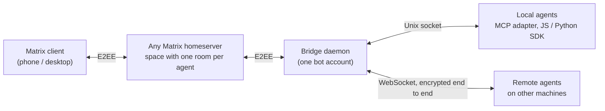

<div align="center">

# mxagent

**Control your AI agents from your phone, through an end-to-end encrypted Matrix space.**

[](#license)
[](https://nodejs.org)
[](clients/python)
[](https://matrix.org)


</div>

Agents that run for a long time need to report progress, ask questions and wait for a "yes, go
ahead". This project gives each of them its own encrypted room in a Matrix space, so you can follow
and steer them from any Matrix client on your phone or desktop. It works with any agent: MCP hosts,
JavaScript or Python programs, and plain terminal programs. Agents never touch Matrix themselves;
a small daemon does that for them.

## How it works



The daemon is the only Matrix client. It accepts messages only from you, on a device you have
verified with cross-signing, and routes each message to the right agent. Agents send replies,
status lines, questions, polls and approval requests back over a simple newline-delimited JSON
protocol.

## Features

| | |
|---|---|
| **Room per agent** | Each agent gets its own encrypted, invite-only room, created on first connect and grouped in your space. |
| **Control room** | One-line status updates from all agents; `@agent` to address one, `@all` to broadcast, `@list` to see who is online, `@update` to tell agents to update themselves. |
| **Approvals** | Agents ask before risky steps; you tap Allow or Deny on your phone. Only votes from your verified devices count; unanswered requests expire (default 15 minutes) and count as Deny. |
| **Polls** | Agents can ask multiple-choice questions, and you can start polls for them. |
| **Delivery receipts** | 👀 means the agent received your message, 💤 means no agent is connected. |
| **Attachments and locations** | Send images, files, audio, video or your location to an agent. |
| **Remote agents** | Agents on other machines connect over a WebSocket link that is encrypted end to end, even behind TLS-terminating proxies. |
| **Less trust in the homeserver** | Your identity and the bot's are pinned locally, replayed events are dropped, and room keys only go to your and the bot's cross-signed devices. See the [security guide](docs/guide/security.md). |
| **Health endpoint** | `GET /health` for monitoring and container health checks. |
| **Any homeserver** | Works with any Matrix homeserver that supports end-to-end encryption and cross-signing. |

## Quick start

You need Node.js 22.18 or newer, a dedicated Matrix account for the bot, your own Matrix account
and a space you created. The [getting started guide](docs/guide/getting-started.md) covers every
step in detail, including remote machines and SSO-only homeservers.

**1. Prepare the bot account** (once, in any Matrix client)

Log in as the bot, set up cross-signing and key backup and save the **recovery key**. From the
bot account, verify your own account, then log out of the bot in that client. Invite the bot to
your space and allow it to add rooms there. Details: [prepare the bot account](docs/guide/getting-started.md#prepare-the-bot-account).

**2. Install and configure**

```sh
git clone https://github.com/Rockykln/mxagent mxagent && cd mxagent
npm ci

mkdir -p "${XDG_CONFIG_HOME:-$HOME/.config}/mxagent"
cat > "${XDG_CONFIG_HOME:-$HOME/.config}/mxagent/bridge.env" <<'ENV'
MXA_HOMESERVER=https://matrix.example.org
MXA_BOT_USER=@agents:example.org
MXA_OWNER=@alice:example.org
MXA_SPACE_ID=!space:example.org
ENV
chmod 600 "${XDG_CONFIG_HOME:-$HOME/.config}/mxagent/bridge.env"
```

**3. Log in, start once, anchor the bot's identity, start again**

```sh
npm run ctl -- login-password    # asks for the bot password (or: npm run ctl -- login-sso)
npm start                        # first start: creates the rooms and the bot device's keys
```

Note the `ed25519 fingerprint` line in the log, then stop the daemon with Ctrl-C.
`cross-sign` asks for the recovery key, shows the device fingerprint and signs the device once you
confirm it matches the logged one. Special cases are covered in the
[guide](docs/guide/getting-started.md):

```sh
npm run ctl -- cross-sign
npm start                        # keep it running
```

Join the control room and the system room the daemon invited you to. Until `cross-sign` has run,
the daemon rejects every owner message and sends nothing. It also sends
nothing while any session of the bot or of your account is not cross-signed, so log out the client
you used in step 1 (details: [unverified devices block sending](docs/guide/getting-started.md#unverified-devices-block-sending)).

**4. Connect an agent**

Through the MCP adapter, in your MCP host's server configuration:

```json
{
  "mcpServers": {
    "bridge": {
      "command": "node",
      "args": ["/path/to/mxagent/adapters/mcp/server.mjs", "--name", "builder"]
    }
  }
}
```

Or from your own code with the JavaScript SDK (a [Python SDK](clients/python) works the same way):

```js
import { connect } from "./clients/js/index.mjs";

const agent = connect({ name: "builder" });
agent.on("message", (msg) => agent.reply(`echo: ${msg.text}`));

await agent.ready();
await agent.status("ready");
```

A room named `builder` appears in your space. Any other language works too: see the
[protocol reference](docs/reference/protocol.md).

## Documentation

Start at the [documentation index](docs/README.md).

| Guides | Reference |
|---|---|
| [Getting started](docs/guide/getting-started.md) | [Agent protocol](docs/reference/protocol.md) |
| [Configuration](docs/guide/configuration.md) | [Protocol test vectors](docs/reference/protocol-test-vectors.md) |
| [Commands](docs/guide/commands.md) | [Architecture](docs/reference/architecture.md) |
| [Security](docs/guide/security.md) | [Internals](docs/reference/internals.md) |
| [FAQ](docs/guide/faq.md) | [Technical changelog](docs/reference/changelog-technical.md) |

Also: [examples](examples/README.md), [deployment](deploy/README.md), [changelog](CHANGELOG.md).

## Security

Read the [security guide](docs/guide/security.md) for the threat model, and report vulnerabilities
privately as described in [SECURITY.md](SECURITY.md).

## Contributing

Issues and pull requests are welcome. See [CONTRIBUTING.md](CONTRIBUTING.md).

## License

The daemon and `mxagentctl` are licensed under [AGPL-3.0-or-later](LICENSE), so modified versions
of the encryption and verification code stay open. The client libraries, the MCP adapter, the examples and
the protocol specification are licensed under Apache-2.0, so you can connect any agent, open or closed.
Details: [LICENSING.md](LICENSING.md).

Copyright © 2026 rockykln
